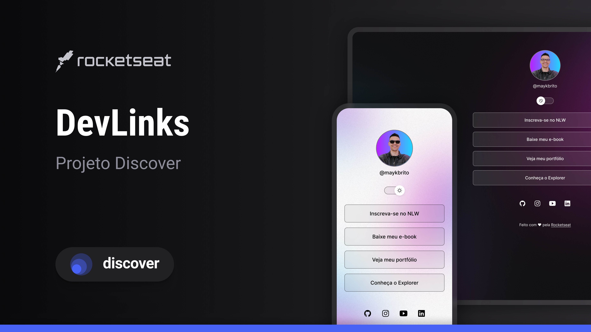

<h1 align="center"> DevLinks 🧩</h1>

Seu cartão de visitas digital, do seu jeito.

  <a href="#-tecnologias">Tecnologias</a>&nbsp;&nbsp;&nbsp;|&nbsp;&nbsp;&nbsp;
  <a href="#-projeto">Projeto</a>

  
 

## 🚀 Tecnologias

Esse projeto foi desenvolvido com as seguintes tecnologias:

- HTML e CSS
- JavaScript
- Git e Github
- Figma

## 💻 Projeto

- O DevLinks é um agregador de links para usar como cartão de visitas online, com foto de perfil, links para LinkedIn, GitHub e Rocketseat e ícones de redes sociais, desenvolvido a partir de um layout no Figma.

- O projeto tem alternância entre tema escuro e claro feita com JavaScript, que troca as variáveis de cor, os fundos de desktop e mobile e a foto de perfil de acordo com o tema.

<h2 align="center">📌 Desenvolvedores</h2>

<table align="center">
  <tr>
    <td align="center">
      <a href="https://github.com/rebellatoGui" title="GitHub">
         
        
          <b>Guilherme Rebellato</b>
        
      </a>
    </td>
  </tr>
</table>

 

---

Feito com ♥ por rebellatoGui

